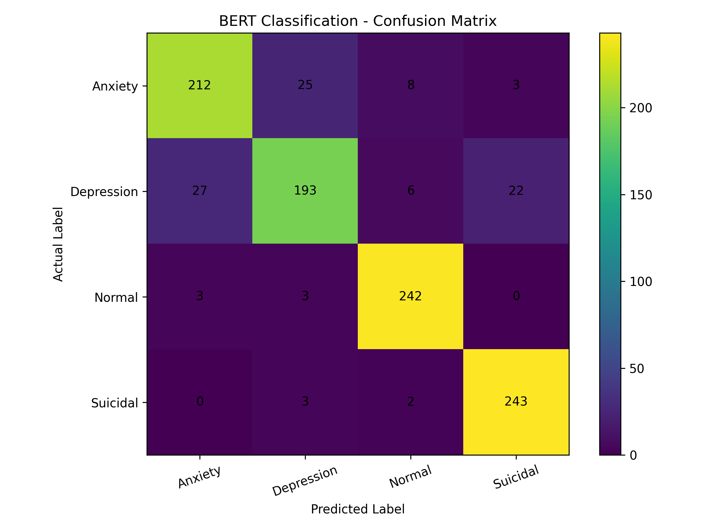
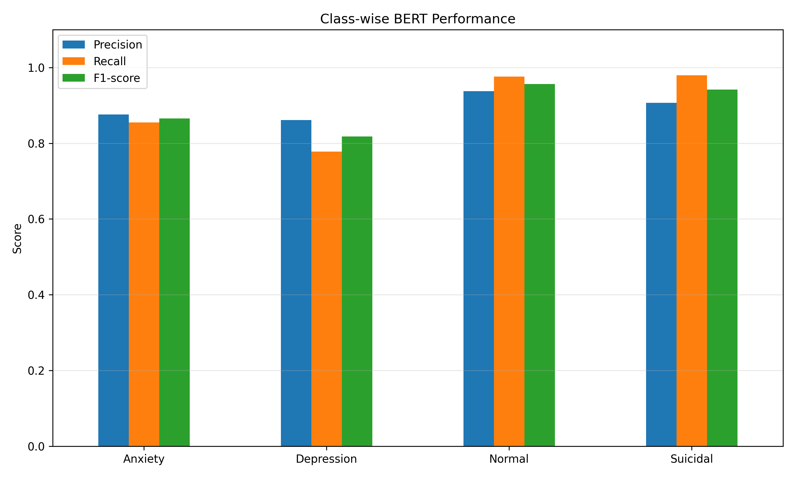
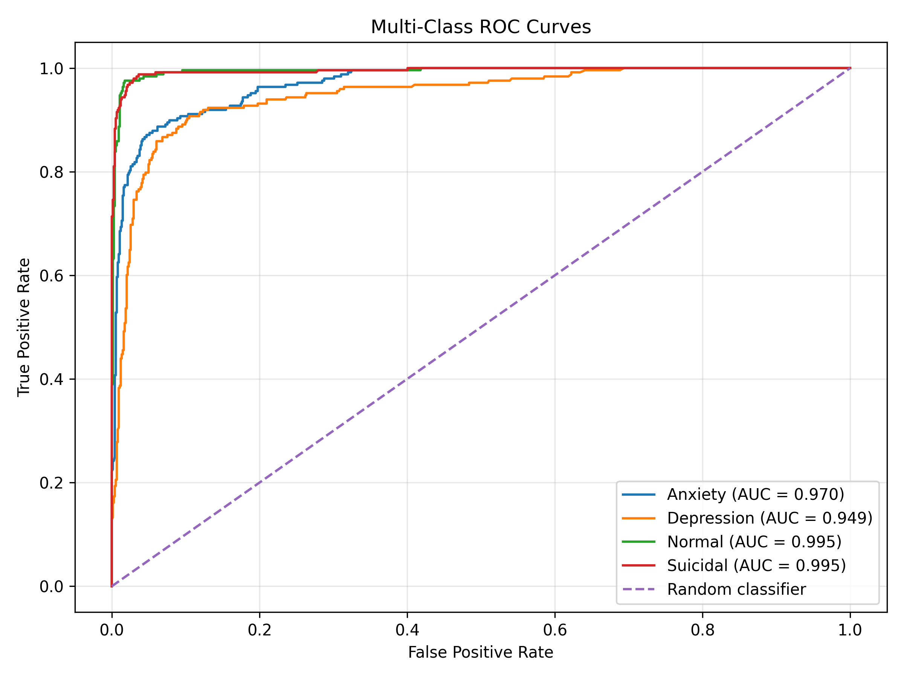
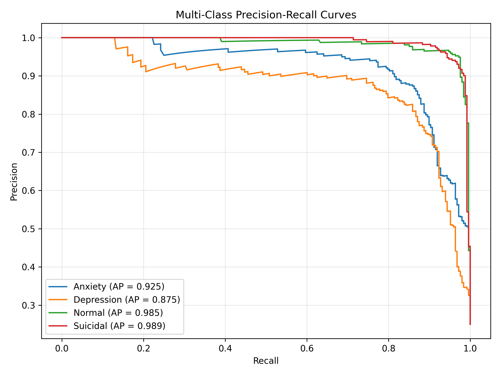
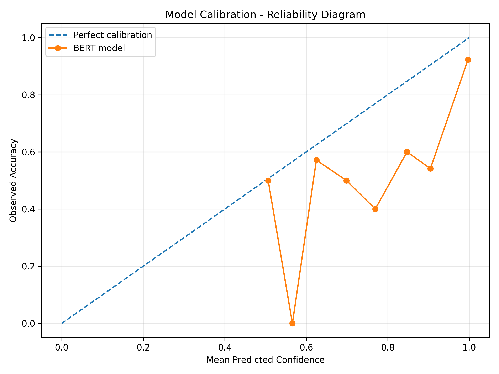
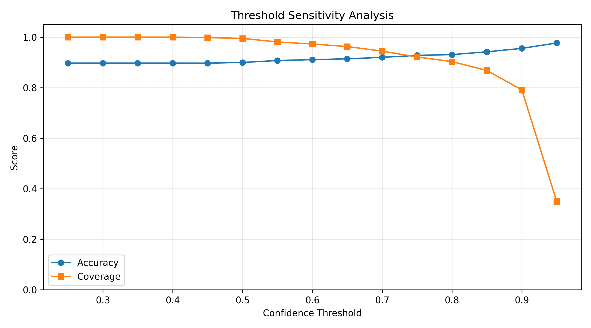

# Mental Health BERT – Java Evaluation & ONNX Deployment

A Java-based evaluation and deployment project using a fine-tuned BERT model for mental health text classification.

The project combines NLP, ONNX Runtime, Java-based inference, model evaluation, explainability and cross-framework validation.

---

## Overview

This project evaluates a pre-trained and fine-tuned BERT model that classifies text into four categories:

* Anxiety
* Depression
* Normal
* Suicidal

The original PyTorch model was converted to ONNX format for deployment using Java and ONNX Runtime.

The project focuses on reproducing model inference in Java, evaluating classification performance and validating the ONNX implementation against the original PyTorch model.

**Important:** The BERT model was already fine-tuned. This project focuses on its deployment, evaluation and validation rather than training the model from scratch.

---

## Dataset

**Source:** Mental Health Text Classification Dataset – Kaggle.

**Test samples:** 992

| Class      | Samples |
| ---------- | ------: |
| Anxiety    |     248 |
| Depression |     248 |
| Normal     |     248 |
| Suicidal   |     248 |
| **Total**  | **992** |

The test dataset contains text samples and their corresponding class labels.

---

## Model Architecture

| Parameter                       | Configuration |
| ------------------------------- | ------------- |
| Architecture                    | BERT          |
| Vocabulary size                 | 30,522        |
| Hidden size                     | 768           |
| Transformer layers              | 12            |
| Attention heads                 | 12            |
| Maximum sequence length         | 128           |
| Output classes                  | 4             |
| Model format for Java inference | ONNX          |

**Original fine-tuned model:** Mental Health BERT Fine-Tunes – Kaggle.

---

## Technology Stack

* Java 17+
* Python (ONNX conversion and supplementary analysis)
* ONNX Runtime
* PyTorch
* Hugging Face Transformers
* WordPiece Tokenization
* OpenCSV
* Maven
* NumPy
* Pandas
* Scikit-learn
* Matplotlib
* LIME

---

## System Architecture

1. Obtain the original fine-tuned PyTorch BERT checkpoint.
2. Export the checkpoint to ONNX format.
3. Load the ONNX model using Java ONNX Runtime.
4. Perform WordPiece tokenization in Java.
5. Generate predictions and class probabilities.
6. Evaluate predictions against the test dataset.
7. Calculate classification and probability-based metrics.
8. Generate evaluation visualizations and explainability results.
9. Compare PyTorch and ONNX model outputs.

Python is used for one-time model conversion and supplementary evaluation analysis. Java handles the deployed inference and primary classification evaluation pipeline.

---

## Java Evaluation Results

The Java implementation was evaluated on all 992 test samples.

| Metric          |      Score |
| --------------- | ---------: |
| Accuracy        | **89.72%** |
| Macro Precision |     0.8956 |
| Macro Recall    |     0.8972 |
| Macro F1-score  | **0.8954** |

### Class-wise Performance

| Class      | Precision | Recall | F1-score |
| ---------- | --------: | -----: | -------: |
| Anxiety    |    0.8760 | 0.8548 |   0.8653 |
| Depression |    0.8616 | 0.7782 |   0.8178 |
| Normal     |    0.9380 | 0.9758 |   0.9565 |
| Suicidal   |    0.9067 | 0.9798 |   0.9419 |

---

## Model Performance Visualizations

### 1. Confusion Matrix

Shows the relationship between actual and predicted classifications.



### 2. Class-wise Performance

Comparison of precision, recall and F1-score across the four categories.



### 3. ROC-AUC Curves

Evaluates the model's ability to distinguish between the four classes using a one-vs-rest approach.



**Macro ROC-AUC: 0.9771**

### 4. Precision-Recall Curves

Shows the precision-recall trade-off for each classification category.



**Macro PR-AUC: 0.9435**

### 5. Calibration Analysis

Examines the relationship between model confidence and prediction correctness.



| Metric                 | Result |
| ---------------------- | -----: |
| Top-label ECE          | 0.0871 |
| Multiclass Brier Score | 0.1864 |

### 6. Threshold Sensitivity Analysis

Examines how confidence-based abstention affects prediction coverage and accuracy.



---

## Additional Evaluation & Explainability

Additional experiments were performed:

| Experiment             | Result                                  |
| ---------------------- | --------------------------------------- |
| Temperature scaling    | Optimal exploratory temperature: 2.2352 |
| Original NLL           | 0.5573                                  |
| Temperature-scaled NLL | 0.3418                                  |
| LIME                   | Local feature-contribution analysis     |
| Threshold sensitivity  | Confidence-based abstention analysis    |

**Calibration limitation:** Temperature scaling was fitted using test-set labels. These results are exploratory and should not be interpreted as unbiased calibration performance. Independent validation data is required for a proper calibration assessment.

LIME explanations are local surrogate approximations and should not be interpreted as literal semantic or psychological explanations.

---

## PyTorch vs ONNX Validation

The original PyTorch model and exported ONNX model were evaluated on all 992 test samples.

| Validation Metric                 |    Result |
| --------------------------------- | --------: |
| Matching predictions              |       992 |
| Mismatching predictions           |         0 |
| Prediction agreement              |  **100%** |
| Maximum absolute logit difference | 0.0000161 |
| PyTorch accuracy                  |    89.72% |
| ONNX accuracy                     |    89.72% |

The results demonstrate prediction-level agreement and very small numerical differences between the two implementations on the evaluated test dataset.

---

## Project Structure

```text
MentalHealthBERT/
│
├── models/
│   ├── config.json
│   └── vocab.txt
│
├── src/
│   └── main/
│       └── java/
│           ├── Main.java
│           ├── Evaluation.java
│           ├── Tokenizer.java
│           └── TokenizerTest.java
│
├── results/
│   ├── model_predictions.csv
│   ├── classification_report.txt
│   ├── confusion_matrix.csv
│   ├── misclassified_examples.csv
│   ├── confusion_matrix.png
│   ├── classwise_performance.png
│   ├── class_distribution.png
│   ├── confidence_distribution.png
│   ├── roc_auc_curves.png
│   ├── precision_recall_curves.png
│   ├── calibration_diagram.png
│   ├── temperature_scaling.png
│   ├── threshold_sensitivity.png
│   ├── lime_explanation.html
│   ├── lime_feature_weights.csv
│   ├── pytorch_onnx_comparison.csv
│   └── full_model_validation.csv
│
├── pom.xml
└── README.md
```

**Note:** The large ONNX model and test CSV are not stored in this GitHub repository. See the setup instructions below.

---

## Model & Dataset Setup

The model and dataset are maintained separately from this repository because of their file size and dataset redistribution considerations.

### 1. Obtain the original model

Download the fine-tuned PyTorch checkpoint from Kaggle:
https://www.kaggle.com/models/priyangshumukherjee/mental-health-bert-fine-tunes?utm_source=chatgpt.com
**Model:** Mental Health BERT Fine-Tunes
**Publisher:** priyangshumukherjee

The downloaded checkpoint contains the model weights and tokenizer configuration.

### 2. Obtain the dataset

Download the original dataset from Kaggle:
https://www.kaggle.com/datasets/priyangshumukherjee/mental-health-text-classification-dataset?utm_source=chatgpt.com
**Dataset:** Mental Health Text Classification Dataset
**Publisher:** priyangshumukherjee

Use the `mental_health_combined_test.csv` file for evaluation.

### 3. Convert the model to ONNX

The Java implementation requires the exported ONNX model.

Use the original PyTorch checkpoint and the ONNX export procedure to generate:

`model.onnx`

Place the exported model in:

`models/model.onnx`

### 4. Arrange the model files

The final local project structure should contain:

```text
models/
├── model.onnx
├── config.json
├── vocab.txt
└── test.csv
```

The model configuration and vocabulary files are already included in this repository.

---

## Running the Java Project

### Requirements

* Java 17 or later
* Maven

### Clone the repository

```bash
git clone YOUR_GITHUB_REPOSITORY_URL
```

### Navigate into the project

```bash
cd Mental-Health-Classification-Java
```

### Compile

```bash
mvn clean compile
```

### Run single-text inference

```bash
mvn exec:java -Dexec.mainClass=Main
```

### Run complete evaluation

```bash
mvn clean compile exec:java -Dexec.mainClass=Evaluation
```

Ensure the ONNX model and test dataset are placed in the expected `models/` directory before running inference and evaluation.

---

## Limitations

* This is an educational and research-oriented NLP project.
* Classification performance depends on the training dataset and its biases.
* Generalization to other datasets and real-world populations has not been established.
* Calibration results require independent validation data.
* LIME explanations are approximate and local.
* Confidence thresholds are experimental and are not clinical decision thresholds.

---

## Responsible Use

This model is intended exclusively for educational and research purposes.

It must not be used as a replacement for professional mental health assessment, diagnosis or emergency support.

It is not a clinical diagnostic system or a suicide-risk assessment tool.

---

## Acknowledgements

* Original fine-tuned model and dataset: priyangshumukherjee, Kaggle.
* Hugging Face Transformers and ONNX Runtime communities.

---

**Project Focus:** Java-based NLP deployment | BERT | ONNX Runtime | Model Evaluation | Explainable AI
